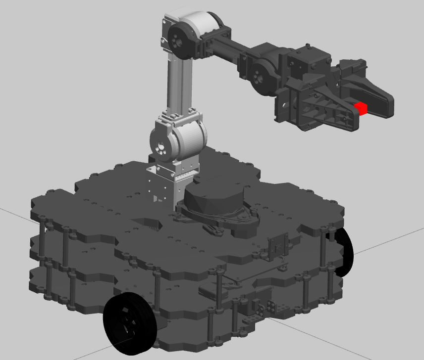

# Mobile Robot with Arm

A ROS 2 mobile manipulation project: a **TurtleBot3 Waffle Pi mobile base** with a **ROBOTIS OpenMANIPULATOR-X** 4-DOF arm and two-finger gripper.

It runs in simulation only, using **ROS 2 Humble** and **Gazebo Classic 11** on Ubuntu 22.04.

Developed as a case study in the M.Eng. Mechatronics programme at TH Deggendorf.



*The robot in Gazebo Classic. This screenshot predates the pickup/drop pedestals.*

## What works today

| Feature | Status |
|---|---|
| Differential-drive base in Gazebo (`/cmd_vel`, `/odom`) | ✅ |
| 2D LiDAR (`/scan`, 360°, 5 Hz) | ✅ |
| OpenMANIPULATOR-X arm + gripper under `ros2_control` | ✅ |
| MoveIt 2 motion planning for the arm (OMPL) | ✅ |
| SLAM mapping with `slam_toolbox` | ✅ |
| Localization (AMCL) + Nav2 navigation on a saved map | ✅ |
| Precise parking at a pedestal (Nav2 staging + LiDAR docking) | ✅ |
| One-command bringup (Gazebo → AMCL → Nav2 → MoveIt) | ✅ |
| Scripted mission: drive → dock → pick → drive → dock → place | ⚠️ The **pick and place are not real yet**: the arm moves through fixed joint poses and the gripper closes on nothing |
| Camera / RGB-D sensing | ❌ Camera frames exist in the URDF, but there is no simulated camera sensor yet |

## Mission

`mobile_manipulation_mission.py` runs this sequence:

1. Wait until Nav2's localization and navigation lifecycle managers report *active*, and until MoveIt and the gripper controller are available.
2. Arm to `home`, gripper open.
3. **Nav2** drives to a staging pose 0.70 m in front of the **pickup pedestal**, facing it.
4. **LiDAR docking:** fit a line to the pedestal face, correct any sideways offset (turn 90°, drive, turn back), square up and creep to 0.17 m from the face.
5. Pick sequence (fixed arm poses for now), arm to carry pose, back off 0.35 m.
6. Repeat steps 3–5 at the **drop pedestal** and place.

Why two stages: Nav2 is good at getting within about 10 cm, but a diff-drive robot cannot slide sideways, and the local controller tends to stall near goals close to obstacles. So Nav2 only brings the robot to open space near the pedestal, and a dedicated docking step does the last half metre with centimetre accuracy.

Result of a headless test run:

| Stop | After Nav2 | After docking |
|---|---|---|
| Pickup pedestal | 0.70 m from face, 7 mm sideways | 0.180 m, 1.4°, 10 mm sideways |
| Drop pedestal | 0.75 m from face, 71 mm sideways | 0.179 m, 1.1°, 5 mm sideways |

## World

`mobile_robot_description/worlds/mobile_robot.world` contains:

- **Arena:** 6 m × 5 m with walls and three box obstacles.
- **Pickup pedestal:** 0.25 × 0.25 × 0.18 m at (2.30, −0.30).
- **Drop pedestal:** same size at (−2.30, 0.0).
- **Cube:** 5 cm red cube on the pickup pedestal, 2 cm behind its front face.

The saved map is `mobile_robot_navigation/maps/mobile_robot_map.*`. It was built with `slam_toolbox`. The pedestals were later drawn into the map image by hand when they replaced earlier, larger tables.

## Software

- Ubuntu 22.04, ROS 2 Humble, Gazebo Classic 11
- `ros2_control`, `gazebo_ros2_control`
- MoveIt 2
- Nav2: AMCL, NavFn planner, **Rotation Shim + Regulated Pure Pursuit** controller
- `slam_toolbox`
- **Cyclone DDS** (recommended, see below)

## Packages

```text
mobile_robot_gripper_ws/src/
├── mobile_robot_description/    URDF/xacro, meshes, world, Gazebo launch
├── mobile_robot_moveit_config/  MoveIt 2 configuration (SRDF, controllers, OMPL)
├── mobile_robot_navigation/     Nav2 + AMCL params, slam_toolbox params, map
├── mobile_robot_bringup/        Unified launch, initial pose, mission script
└── turtlebot3_manipulation/     External ROBOTIS dependency (not in this repo)
```

## Setup

### 1. Dependencies

```bash
sudo apt install ros-humble-desktop ros-humble-gazebo-ros-pkgs \
  ros-humble-gazebo-ros2-control ros-humble-ros2-control ros-humble-ros2-controllers \
  ros-humble-moveit ros-humble-navigation2 ros-humble-nav2-bringup \
  ros-humble-slam-toolbox ros-humble-rmw-cyclonedds-cpp
```

### 2. External ROBOTIS package

The OpenMANIPULATOR-X description comes from the official ROBOTIS TurtleBot3 Manipulation packages. This repository's `.gitignore` excludes it, so clone it yourself:

```bash
cd ~/mobile_robot_gripper_ws/src
git clone -b humble https://github.com/ROBOTIS-GIT/turtlebot3_manipulation.git
```

### 3. Use Cyclone DDS

With the default Fast DDS, Nav2/AMCL sometimes never finished activating on a loaded machine, because lifecycle service replies were lost. Cyclone DDS fixed this. Add it to `~/.bashrc`:

```bash
export RMW_IMPLEMENTATION=rmw_cyclonedds_cpp
```

### 4. Build

```bash
cd ~/mobile_robot_gripper_ws
source /opt/ros/humble/setup.bash
colcon build --symlink-install
source install/setup.bash
```

## Run

### Full mobile manipulation demo

Terminal 1, simulation + localization + Nav2 + MoveIt:

```bash
ros2 launch mobile_robot_bringup mobile_manipulation.launch.py
```

Add `gui:=false` to run Gazebo without its window. It is much lighter on CPU.

Terminal 2, once Nav2 reports `Managed nodes are active`:

```bash
ros2 run mobile_robot_bringup mobile_manipulation_mission.py
```

The mission waits for Nav2 to be active by itself. It ends with `MISSION COMPLETE` or `MISSION ABORTED`.

### Individual parts

```bash
# Gazebo + robot + controllers only
ros2 launch mobile_robot_description gazebo.launch.py

# Arm and gripper test sequence
ros2 run mobile_robot_description arm_gripper_test.py

# MoveIt 2 (with Gazebo running)
ros2 launch mobile_robot_moveit_config move_group.launch.py
ros2 launch mobile_robot_moveit_config moveit_rviz.launch.py

# Build a new map with SLAM (drive with teleop), then save it
ros2 launch mobile_robot_navigation slam.launch.py
ros2 run teleop_twist_keyboard teleop_twist_keyboard

# Localization + navigation on the saved map
ros2 launch mobile_robot_navigation localization.launch.py
ros2 launch mobile_robot_navigation navigation.launch.py
```

Check the controllers:

```bash
ros2 control list_controllers
# joint_state_broadcaster, arm_controller, gripper_controller should be active
```

## Main interfaces

| Interface | Type |
|---|---|
| `/cmd_vel`, `/odom`, `/scan`, `/joint_states` | topics |
| `/navigate_to_pose` | Nav2 action |
| `/move_action` | MoveIt MoveGroup action |
| `/arm_controller/follow_joint_trajectory` | arm trajectory action |
| `/gripper_controller/gripper_cmd` | gripper action |

## Development history

| Phase | Content | Status |
|---|---|---|
| 1 | TurtleBot3 Waffle Pi base, diff drive, sensors' frames, stable contacts | ✅ |
| 2 | OpenMANIPULATOR-X + gripper, `ros2_control`, arm/gripper test | ✅ |
| 3 | MoveIt 2 configuration, plan + execute in Gazebo | ✅ |
| 4 | Simulated LiDAR, SLAM, AMCL, Nav2 | ✅ |
| 5 | Unified bringup, scripted mission | ✅ |
| 6 | Pedestals, Regulated Pure Pursuit, LiDAR docking | ✅ |
| 7 | **Real grasp:** cube-relative arm targets, grasp tuning, grasp check | ⏳ next |
| 8 | Simulated camera + cube detection | ⏳ planned |
| 9 | Robustness (retries), demo video, report | ⏳ planned |

## Known limitations

- The pick and place are not real yet (see phase 7).
- There is no simulated camera; the camera exists only as TF frames.
- Simulation only; not tested on a physical robot.
- On a modest laptop the simulation runs at about 0.3–0.5× real time. Running with `gui:=false` helps.

## Author

**Muhammad Ali Sadiq**, M.Eng. Mechatronics, TH Deggendorf
