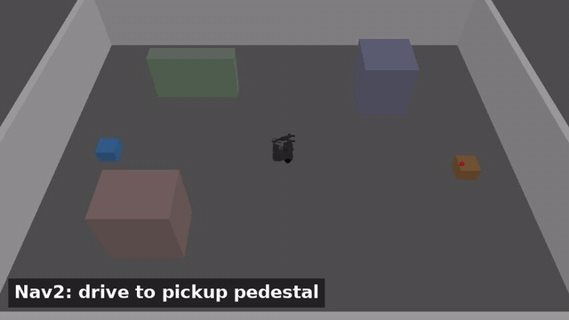
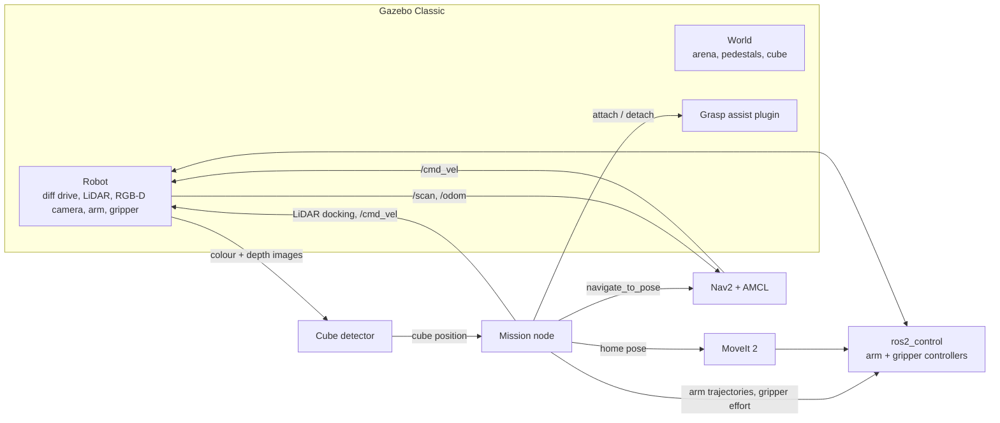

# Mobile Robot with Arm

[](https://github.com/turtleshelp/mobile-robot-with-arm/actions/workflows/build.yml)

An autonomous mobile manipulator in simulation: a **TurtleBot3 Waffle Pi** base with a **ROBOTIS OpenMANIPULATOR-X** arm. It drives to a pedestal, finds the cube on it with its RGB-D camera, picks it up, carries it across the room and places it on a second pedestal.

Built with **ROS 2 Humble**, **Gazebo Classic 11**, **Nav2** and **MoveIt 2** on Ubuntu 22.04, as a case study in the M.Eng. Mechatronics programme at TH Deggendorf.



*One full autonomous run, sped up. The inset shows what the robot camera sees when it finds the cube. Full video: [docs/media/mobile_manipulation_demo.mp4](docs/media/mobile_manipulation_demo.mp4)*

## Features

- **Navigation:** SLAM-built map, AMCL localization, Nav2 with a Rotation Shim + Regulated Pure Pursuit controller
- **Precise parking:** a LiDAR docking step squares the robot up to the pedestal to within about 2 cm and 2°
- **Perception:** an RGB-D camera (at the Waffle Pi camera position) finds the red cube by colour, reads its distance from the depth image and computes its 3D position. Tested with the cube placed randomly on the pedestal (±5 cm sideways, ±15° turned), the camera estimate was within 1–3 mm of the true position.
- **Manipulation:**
  - the grasp targets the cube where the camera saw it
  - analytic inverse kinematics for the 4-DOF arm
  - straight-line approach and lift
  - an effort-controlled gripper
- **Safety checks:** localization is checked on arrival at each pedestal, the arm's path is checked before moving near the cube, and the grasp is verified before lifting
- **One-command bringup:** Gazebo, `ros2_control`, AMCL, Nav2 and MoveIt start together

## How it fits together



| Package | Contents |
|---|---|
| `mobile_robot_description` | URDF/xacro, world, Gazebo launch, controller config, grasp assist plugin |
| `mobile_robot_navigation` | Nav2, AMCL and `slam_toolbox` parameters, saved map |
| `mobile_robot_moveit_config` | MoveIt 2 configuration |
| `mobile_robot_perception` | cube detector (colour segmentation + depth, 3D position in the odom frame) |
| `mobile_robot_bringup` | unified launch and the mission node |

## Quick start

Requires Ubuntu 22.04 with ROS 2 Humble.

```bash
# 1. Get the workspace and the ROBOTIS arm description (pinned to the tested version)
git clone https://github.com/turtleshelp/mobile-robot-with-arm.git ~/mobile_robot_gripper_ws
cd ~/mobile_robot_gripper_ws/src
git clone -b humble https://github.com/ROBOTIS-GIT/turtlebot3_manipulation.git
git -C turtlebot3_manipulation checkout 814f140

# 2. Dependencies
sudo apt install ros-humble-desktop ros-humble-gazebo-ros-pkgs \
  ros-humble-gazebo-ros2-control ros-humble-ros2-control ros-humble-ros2-controllers \
  ros-humble-moveit ros-humble-navigation2 ros-humble-nav2-bringup \
  ros-humble-slam-toolbox ros-humble-rmw-cyclonedds-cpp

# 3. Build
cd ~/mobile_robot_gripper_ws
source /opt/ros/humble/setup.bash
colcon build --symlink-install
```

Run it in two terminals. In both, first run:

```bash
source ~/mobile_robot_gripper_ws/install/setup.bash
export RMW_IMPLEMENTATION=rmw_cyclonedds_cpp
```

Then:

```bash
# Terminal 1: simulation, localization, Nav2, MoveIt (add gui:=false to run without the Gazebo window)
ros2 launch mobile_robot_bringup mobile_manipulation.launch.py

# Terminal 2: the pick-and-place mission (waits for Nav2 by itself)
ros2 run mobile_robot_bringup mobile_manipulation_mission.py
```

The mission ends with `MISSION COMPLETE` or `MISSION ABORTED`. Cyclone DDS is recommended because with the default Fast DDS, Nav2 sometimes never finished starting on a busy machine. To make it permanent, add the `export` line to `~/.bashrc`.

<details>
<summary>Running individual parts</summary>

```bash
# Gazebo + robot + controllers only
ros2 launch mobile_robot_description gazebo.launch.py

# MoveIt 2 (with Gazebo running)
ros2 launch mobile_robot_moveit_config move_group.launch.py
ros2 launch mobile_robot_moveit_config moveit_rviz.launch.py

# Build a new map with SLAM, driving with the keyboard
ros2 launch mobile_robot_navigation slam.launch.py
ros2 run teleop_twist_keyboard teleop_twist_keyboard

# Localization + navigation on the saved map
ros2 launch mobile_robot_navigation localization.launch.py
ros2 launch mobile_robot_navigation navigation.launch.py
```

</details>

## Results

Every run starts a fresh simulation, and a run only counts as a success if Gazebo shows the cube upright on the drop pedestal afterwards.

- **With camera detection and a randomly placed cube:** every run in which the camera got to look completed the pick and place, with the camera within 1–3 mm of the true cube position. The failures found along the way were caught by the safety checks before the arm moved, and each was fixed (see [docs/results.md](docs/results.md)).
- **Grasps:** none failed once the robot reached the cube; the cube was within about 1 cm of the planned grasp point every time.
- **Parking:** after docking, the robot was within 2 cm and 2° of the target at both pedestals.


*What the robot's camera sees from 0.7 m: the detected cube (here 5 cm off-centre) with its distance and 3D position.*

A fresh clone of this repository, set up by following only this README, builds and completes the mission. Details: [docs/results.md](docs/results.md).

## Limitations

- **Simulation only;** not tested on a physical robot.
- **Grasp assist:** holding the cube relies on a simulation-only plugin that attaches it to the gripper, but only once the cube is verified between the jaws. Gazebo Classic's physics cannot hold an object with the 1 g ROBOTIS finger links. See [docs/design.md](docs/design.md#grasp-assist-simulation-only).
- **Simple perception:** the detector looks for one saturated red object, so it assumes the cube is the only red thing in view. The cube's height is taken from the known pedestal; x and y come from the camera. The cube must sit near the front edge of the pedestal (within about 2.5 cm), otherwise the gripper palm would hit the pedestal; the mission checks this and refuses instead.
- **Localization:** in one early run, AMCL started with a wrong position; the cause could not be reproduced in later runs. AMCL now sets its own start pose, and the mission checks that the pedestal is where the map says before the arm moves, so a localization error stops the mission safely instead of grasping at the wrong place.
- **Speed:** the simulation runs at about 0.3–0.5× real time on a modest laptop.

## Documentation

- [docs/design.md](docs/design.md): mission sequence, two-stage parking, cube detection, arm motion strategy, grasp assist, changes to the ROBOTIS setup, world and interfaces
- [docs/results.md](docs/results.md): repeatability, parking accuracy, problems found by testing and their fixes

## License

Apache License 2.0, see [LICENSE](LICENSE). The ROBOTIS TurtleBot3 Manipulation packages, cloned separately, are under their own license.

## Author

**Muhammad Ali Sadiq**, M.Eng. Mechatronics, TH Deggendorf
