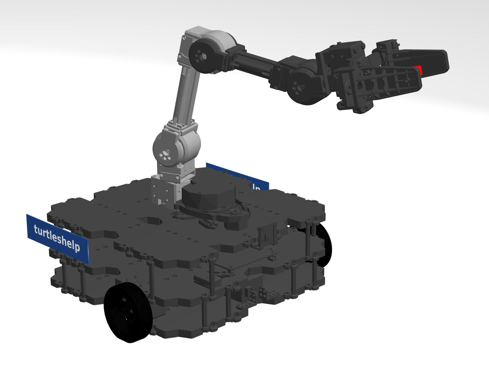
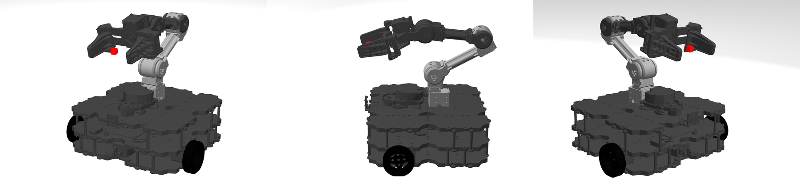
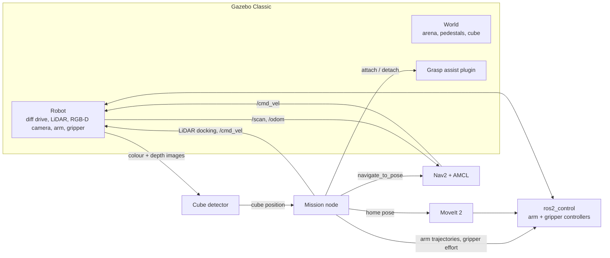
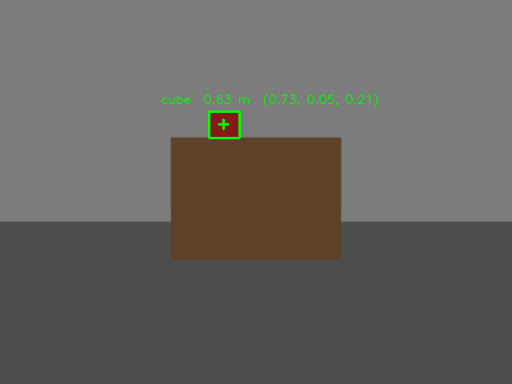

# Mobile Robot with Arm

[](https://github.com/turtleshelp/mobile-robot-with-arm/actions/workflows/build.yml)

An autonomous mobile manipulator in simulation: a **TurtleBot3 Waffle Pi** base with a **ROBOTIS OpenMANIPULATOR-X** arm. It drives to a pedestal, finds the cube on it with its RGB-D camera, picks it up, carries it across the room and places it on a second pedestal.

Built with **ROS 2 Humble**, **Gazebo Classic 11**, **Nav2** and **MoveIt 2** on Ubuntu 22.04, as a case study in the M.Eng. Mechatronics & Cyber-Physical Systems programme at TH Deggendorf.


*One full autonomous run, sped up. The inset shows what the robot camera sees when it finds the cube. Full video: [docs/media/mobile_manipulation_demo.mp4](docs/media/mobile_manipulation_demo.mp4)*

## The robot

<p align="center"></p>



*The simulated robot: a TurtleBot3 Waffle Pi base with a 2D LiDAR and an RGB-D camera, and a 4-DOF OpenMANIPULATOR-X arm with a two-finger gripper. Rendered in Gazebo.*

## Features

- **Navigation:** SLAM-built map, AMCL localization, Nav2 with a Rotation Shim + Regulated Pure Pursuit controller
- **Precise parking:** a LiDAR docking step squares the robot up to the pedestal to within about 1–3 cm and 2°
- **Perception:** an RGB-D camera (at the Waffle Pi camera position) finds the red cube by colour, reads its distance from the depth image and computes its 3D position. Tested with the cube placed randomly on the pedestal (±5 cm sideways, ±15° turned), the camera estimate was within 1–3 mm of the true position.
- **Manipulation:**
  - the grasp targets the cube where the camera saw it
  - analytic inverse kinematics for the 4-DOF arm
  - straight-line approach and lift
  - an effort-controlled gripper
- **Safety checks:** localization is checked on arrival at each pedestal, the arm's path is checked before moving near the cube, and the grasp is verified before lifting
- **One-command bringup:** Gazebo, `ros2_control`, AMCL, Nav2 and MoveIt start together

## How it fits together



| Package | Contents |
|---|---|
| `mobile_robot_description` | URDF/xacro, world, Gazebo launch, controller config, grasp assist plugin |
| `mobile_robot_navigation` | Nav2, AMCL and `slam_toolbox` parameters, saved map |
| `mobile_robot_moveit_config` | MoveIt 2 configuration |
| `mobile_robot_perception` | cube detector (colour segmentation + depth, 3D position in the odom frame) |
| `mobile_robot_bringup` | unified launch and the mission node |

## Quick start

Requires Ubuntu 22.04 with ROS 2 Humble. On a newer Ubuntu, see [Running with Docker](#running-with-docker).

```bash
# 1. Get the workspace and the ROBOTIS arm description (pinned to the tested version)
git clone https://github.com/turtleshelp/mobile-robot-with-arm.git ~/mobile_robot_gripper_ws
cd ~/mobile_robot_gripper_ws/src
git clone -b humble https://github.com/ROBOTIS-GIT/turtlebot3_manipulation.git
git -C turtlebot3_manipulation checkout 814f140

# 2. Dependencies
sudo apt install ros-humble-desktop ros-humble-gazebo-ros-pkgs \
  ros-humble-gazebo-ros2-control ros-humble-ros2-control ros-humble-ros2-controllers \
  ros-humble-moveit ros-humble-navigation2 ros-humble-nav2-bringup \
  ros-humble-slam-toolbox ros-humble-rmw-cyclonedds-cpp \
  python3-rosdep ffmpeg

# 2b. Everything else the packages declare (e.g. dynamixel_sdk and
#     cartographer_ros for the ROBOTIS package). rosdep init is only
#     needed once per machine; ignore its error if it was already done.
sudo rosdep init
rosdep update
cd ~/mobile_robot_gripper_ws
source /opt/ros/humble/setup.bash
rosdep install --from-paths src --ignore-src -r -y

# 3. Build
cd ~/mobile_robot_gripper_ws
source /opt/ros/humble/setup.bash
colcon build --symlink-install
```

Run it in two terminals. In both, first run:

```bash
source ~/mobile_robot_gripper_ws/install/setup.bash
export RMW_IMPLEMENTATION=rmw_cyclonedds_cpp
```

Then:

```bash
# Terminal 1: simulation, localization, Nav2, MoveIt (add gui:=false to run without the Gazebo window)
ros2 launch mobile_robot_bringup mobile_manipulation.launch.py

# Terminal 2: the pick-and-place mission (waits for Nav2 by itself)
ros2 run mobile_robot_bringup mobile_manipulation_mission.py
```

The mission ends with `MISSION COMPLETE` or `MISSION ABORTED`. Cyclone DDS is recommended because with the default Fast DDS, Nav2 sometimes never finished starting on a busy machine. To make it permanent, add the `export` line to `~/.bashrc`.

<details>
<summary>Running individual parts</summary>

```bash
# Gazebo + robot + controllers only
ros2 launch mobile_robot_description gazebo.launch.py

# MoveIt 2 (with Gazebo running)
ros2 launch mobile_robot_moveit_config move_group.launch.py
ros2 launch mobile_robot_moveit_config moveit_rviz.launch.py

# Build a new map with SLAM, driving with the keyboard
ros2 launch mobile_robot_navigation slam.launch.py
ros2 run teleop_twist_keyboard teleop_twist_keyboard

# Localization + navigation on the saved map
ros2 launch mobile_robot_navigation localization.launch.py
ros2 launch mobile_robot_navigation navigation.launch.py
```

</details>

### Running with Docker

ROS 2 Humble and Gazebo Classic are not packaged for Ubuntu 24.04 or later. There, run the workspace in an Ubuntu 22.04 container; the Gazebo window still opens on your desktop. Tested on Ubuntu 24.04.

```bash
# 1. Docker (once per machine; log out and back in afterwards)
sudo apt install docker.io docker-buildx
sudo usermod -aG docker $USER

# 2. Get the workspace and the ROBOTIS arm description, as in the quick start
git clone https://github.com/turtleshelp/mobile-robot-with-arm.git ~/mobile_robot_gripper_ws
cd ~/mobile_robot_gripper_ws/src
git clone -b humble https://github.com/ROBOTIS-GIT/turtlebot3_manipulation.git
git -C turtlebot3_manipulation checkout 814f140

# 3. Build the image (once, about 10-20 min) and the workspace
cd ~/mobile_robot_gripper_ws
docker/run.sh image
docker/run.sh build
```

Then, in two terminals:

```bash
# Terminal 1: simulation, localization, Nav2, MoveIt (extra arguments go to the launch, e.g. gui:=false)
docker/run.sh sim

# Terminal 2: the pick-and-place mission
docker/run.sh mission
```

`docker/run.sh shell` opens a shell in the container with the workspace sourced, and `docker/run.sh stop` stops the container and everything in it. The workspace is mounted at `/ws`, so code edits on the host are picked up after `docker/run.sh build`.

**GPU.** With an NVIDIA GPU, install the [NVIDIA Container Toolkit](https://docs.nvidia.com/datacenter/cloud-native/container-toolkit/latest/install-guide.html) and run `sudo nvidia-ctk runtime configure --runtime=docker && sudo systemctl restart docker`; `run.sh` then renders on the NVIDIA GPU, also on laptops where the integrated GPU drives the screen. Without it, rendering runs on the CPU, which works but is noticeably slower. The container's Ubuntu 22.04 graphics drivers do not support recent Intel integrated GPUs (for example Arrow Lake), so these are not used by default; to try one anyway, run `docker/run.sh stop` and then `GPU=intel docker/run.sh sim`. The GPU choice is made when the container starts.

## Results

Every run starts a fresh simulation, and a run only counts as a success if Gazebo shows the cube upright on the drop pedestal afterwards.

- **With camera detection and a randomly placed cube:** every run in which the camera got to look completed the pick and place, with the camera within 1–3 mm of the true cube position. The failures found along the way were caught by the safety checks before the arm moved, and each was fixed (see [docs/results.md](docs/results.md)).
- **Grasps:** none failed once the robot reached the cube; the cube was within about 1 cm of the planned grasp point every time.
- **Parking:** after docking, the robot was on average 1.2–1.6 cm (at most 3.3 cm) sideways and at most 2° off the target. Nav2 alone was up to 12.7 cm off.



*What the robot's camera sees from 0.7 m: the detected cube (here 5 cm off-centre) with its distance and 3D position.*

A fresh clone of this repository, set up by following only this README, builds and completes the mission. Details: [docs/results.md](docs/results.md).

To repeat the tests or re-record the demo yourself (headless, after building):

```bash
tools/run_trials.sh 5      # 5 missions, cube placed randomly each time; prints a summary
tools/record_demo.sh       # one recorded mission, cut into an MP4 and a GIF (needs ffmpeg)
```

## Limitations

- **Simulation only;** not tested on a physical robot.
- **Grasp assist:** holding the cube relies on a simulation-only plugin that attaches it to the gripper, but only once the cube is verified between the jaws. Gazebo Classic's physics cannot hold an object with the 1 g ROBOTIS finger links. See [docs/design.md](docs/design.md#grasp-assist-simulation-only).
- **Simple perception:** the detector looks for one saturated red object, so it assumes the cube is the only red thing in view. The cube's height is taken from the known pedestal; x and y come from the camera. The cube must sit near the front edge of the pedestal (within about 2.5 cm), otherwise the gripper palm would hit the pedestal; the mission checks this and refuses instead.
- **Localization:** in one early run, AMCL started with a wrong position; the cause could not be reproduced in later runs. AMCL now sets its own start pose, and the mission checks that the pedestal is where the map says before the arm moves, so a localization error stops the mission safely instead of grasping at the wrong place.
- **Release is not checked:** in one run Gazebo became unstable while the cube was being released, and the robot and cube were thrown out of the arena, but the mission still printed `MISSION COMPLETE`. Results are therefore always judged by Gazebo's ground truth. A check after placing is planned.
- **Speed:** the simulation runs at about 0.3–0.5× real time on a modest laptop.

## Documentation

- [docs/design.md](docs/design.md): mission sequence, two-stage parking, cube detection, arm motion strategy, grasp assist, changes to the ROBOTIS setup, world and interfaces
- [docs/results.md](docs/results.md): repeatability, parking accuracy, problems found by testing and their fixes
- [Case study report (PDF)](docs/report/report.pdf): IEEE-style report with design, equations, evaluation of all logged runs, charts and discussion. LaTeX source, data and chart scripts are in [docs/report/](docs/report/).

## License

Apache License 2.0, see [LICENSE](LICENSE). The ROBOTIS TurtleBot3 Manipulation packages, cloned separately, are under their own license.

If you use, modify or redistribute this project, the license requires you to keep the attribution in [NOTICE](NOTICE) (Apache-2.0, section 4(d)). The simulation also shows it: `github.com/turtleshelp` on the arena floor and on name plates on both sides of the robot. If you build on this work, please keep those and cite it; GitHub's "Cite this repository" button uses [CITATION.cff](CITATION.cff).

## Author

**Muhammad Ali Sadiq**, M.Eng. Mechatronics & Cyber-Physical Systems, TH Deggendorf
